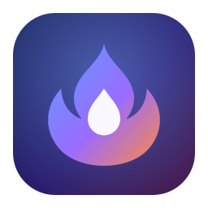
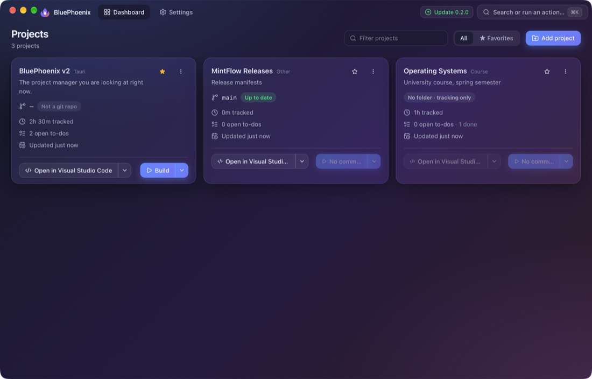
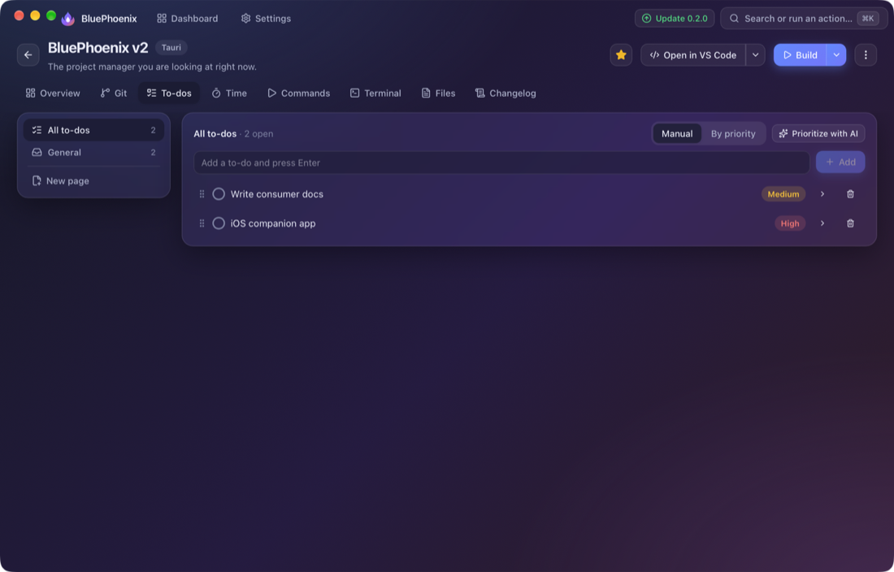
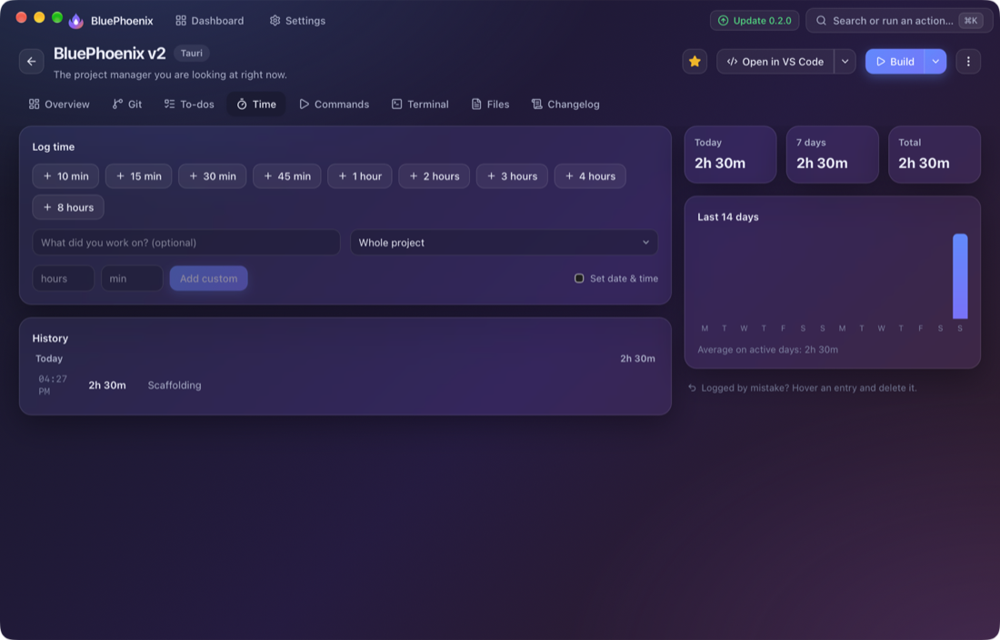
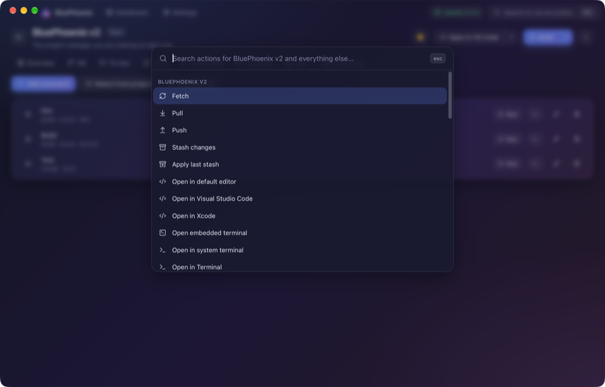
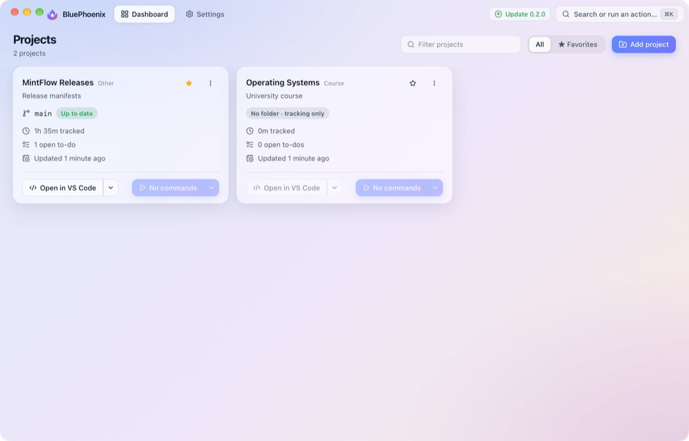

<div align="center">



# BluePhoenix

**Every project. One calm place.**

A beautiful project manager for developers (and anyone with projects to track).<br/>
See each project's real git state, run builds, jump into any editor, keep to-dos and time, and let AI do the boring parts.




</div>

---

## Why BluePhoenix?

If you juggle several projects, you know the routine: open a terminal, `cd`, `git status`, remember what you were doing, find the build command, open the editor. BluePhoenix puts all of that on one dashboard, so switching projects takes a click instead of a minute.

## What you get

### A dashboard that tells you where things stand

Every project is a card with its **current branch and state** (up to date, 2 to push, 3 uncommitted changes, conflicts…), time tracked, open to-dos and when it last changed. Under the divider sit the actions you use most: **open in your editor** and **run your build**, each with a drop-down for alternatives. Star favourites, and use the ⋯ menu for fetch, pull, push, stash, GitHub, website and more.

### Git without leaving the app

Fetch, pull, push, stash and apply a stash from any card. In the Git tab you can stage files, read diffs, commit, create, switch and merge branches, and browse history. BluePhoenix uses the git already on your computer, so your SSH keys and credentials just work.

### Open anything, anywhere

Open a project in **VS Code, Cursor, Zed, Sublime, JetBrains IDEs, Xcode** and more, or in your favourite terminal, or in the **built-in terminal** with tabs per project. Commands for building, testing and starting your app are **detected automatically** for Node, Rust, Python, Go, Java, PHP, Flutter, Swift, .NET, Make and more. Add your own any time.

### To-dos with real structure

Per-project to-dos with **custom pages**, **Markdown notes**, priorities, due dates and drag-to-reorder. Perfect for roadmaps, bug lists, or exam prep.

<div align="center"></div>

### Time tracking in one click

Press **10 min, 15 min, 30 min, 1 hour, 2 hours, 3 hours…** and the time is logged with a timestamp, on the whole project or on a single to-do. See today, this week and a 14-day chart.

<div align="center"></div>

### AI that saves you typing

Write **commit messages**, **prioritize your to-dos**, turn a to-do into a **prompt for your AI coding assistant**, generate and summarize **changelogs**, and **scan a repository for commands**. Run it **locally** with Ollama, LM Studio or a llama.cpp GGUF model so nothing leaves your computer, or use **OpenAI, Anthropic, OpenRouter, Google Gemini, Groq, Mistral, DeepSeek, xAI, Together** or any OpenAI-compatible service. API keys live in your system keychain.

### A command palette for everything

Press **⌘K** (or **Ctrl+K**) for a frosted palette that runs any action: jump to a project, fetch, run a command, log 30 minutes, switch theme.

<div align="center"></div>

### Your files, one click away

Every file in a project is indexed and searchable. Click one to open it in your editor.

### Sync to your iPhone, on your own database

Connect a PostgreSQL database you own (**[Neon](https://neon.tech) by default**, free to start) and your projects, to-dos, notes and time stay in sync across your computers and the **iPhone app**, where you can tick off to-dos, edit notes and log time on the go. No account with us, nothing in our cloud.

### Made to look good

Frosted glass, a soft gradient, a custom title bar and a **light and dark theme** that follows your system. Five accent colours to make it yours.

<div align="center"></div>

---

## Get started

1. **Download** the installer for your system and run it.

   | System | Installer |
   | --- | --- |
   | macOS | `.dmg`, then drag BluePhoenix into Applications |
   | Windows | `.exe` or `.msi` |
   | Linux | `.AppImage` or `.deb` |
   | iPhone | Build it from `ios/` (see below) |

   > Builds are not code-signed yet. On macOS right-click the app and choose **Open** the first time. On Windows choose **More info → Run anyway**.

2. **Add a project**: click **Add project**, pick its folder, and BluePhoenix detects the type, GitHub link and commands. Tracking a university course? Choose **Track something without a folder**.
3. **Optional**: connect AI in **Settings → AI** and cloud sync in **Settings → Cloud sync**.

BluePhoenix checks for updates when it starts and shows a button when a new version is out. It downloads the installer for you.

## Learn more

The full **[user guide](docs/README.md)** covers everything: [getting started](docs/getting-started.md) · [the dashboard](docs/dashboard.md) · [git](docs/git.md) · [editors, terminals and commands](docs/editors-terminals-commands.md) · [to-dos](docs/todos.md) · [time tracking](docs/time-tracking.md) · [AI setup](docs/ai.md) · [cloud sync and iPhone](docs/sync.md) · [troubleshooting](docs/troubleshooting.md).

## Your data and privacy

Everything is stored on your computer. Data only leaves it if you turn on cloud sync (to a database you control) or use a cloud AI provider (only when you press an AI button). Removing a project never deletes your files.

---

## For developers

BluePhoenix is a [Tauri v2](https://tauri.app) app: a Rust backend and a React + TypeScript + Tailwind interface, plus a SwiftUI iPhone app.

**Requirements:** Node.js 20+, pnpm, [Rust](https://rustup.rs). Platform extras: Xcode Command Line Tools (macOS), Microsoft C++ Build Tools (Windows), [Tauri's Linux libraries](https://tauri.app/start/prerequisites/#linux). iPhone app: Xcode and [XcodeGen](https://github.com/yonaskolb/XcodeGen).

| Task | macOS / Linux | Windows |
| --- | --- | --- |
| Run in development | `scripts/dev.sh` | `scripts\dev.bat` |
| Build installers | `scripts/build-macos.sh` (`--universal` for Intel + Apple Silicon) | `scripts\build-windows.bat` |
| Linux installers | `scripts/build-linux.sh` | n/a |

Installers land in `src-tauri/target/release/bundle/`. Each script checks its prerequisites first. Tests: `pnpm test`, `pnpm typecheck`, and `cargo test` in `src-tauri`.

```
src/         React UI (Vite, Tailwind v4, Zustand, cmdk, xterm.js, CodeMirror)
src-tauri/   Rust backend: git, PTY terminals, launchers, AI providers, updater, SQLite, Postgres sync
ios/         SwiftUI app (PostgresNIO); run `xcodegen generate` in ios/, see ios/README.md
docs/        User guide
scripts/     Dev and installer scripts
```

**How it works in brief:** local data lives in SQLite. Git is the `git` CLI. Sync pushes and pulls rows to PostgreSQL with last-write-wins on `updated_at` and deletion tombstones, using a server-side timestamp for pulling (`src-tauri/src/sync.rs`; the iPhone app implements the same rules). AI providers speak the OpenAI-compatible API or Anthropic's.

**Releasing:** set the version in `package.json`, `src-tauri/Cargo.toml`, `src-tauri/tauri.conf.json` and `ios/project.yml`, build, upload the installers, then update `bluephoenix-v.json` (`{"latest": "x.y.z"}`) and `bluephoenix-d.json` (download links per platform) in the MintFlow-Releases repository. The app reads those two files to offer updates.

---

<div align="center">

Developed by **[MintFlow Technologies](https://mintflow.dev)** · Lead developer: **Luca Montanari**

</div>
